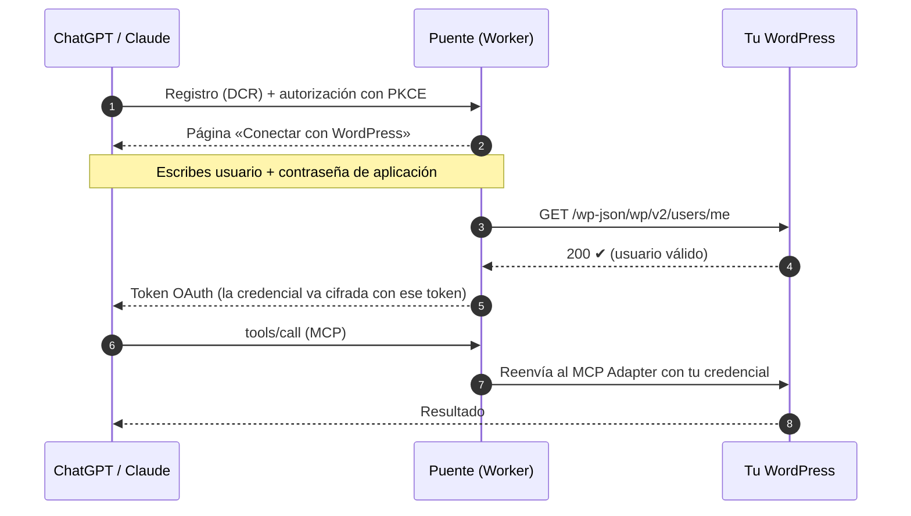

<div align="center">

# 🌉 mcp-bridge-wordpress

**Conecta tu WordPress a ChatGPT y Claude en dos minutos, sin plugins de OAuth y sin guardar contraseñas.**

Un puente OAuth 2.1 en Cloudflare Workers para el MCP oficial de WordPress ([MCP Adapter](https://wordpress.org/plugins/mcp-adapter/)).

[](LICENSE)
[](https://workers.cloudflare.com/)
[](https://modelcontextprotocol.io/)
[](https://oauth.net/2.1/)
[](https://wordpress.org/)

</div>

---

> *«Publica esta noticia con este cartel.» «Pon un aviso del corte de agua de mañana.» «Añade esta asociación con sus fotos.»*
>
> Dicho en ChatGPT o en Claude, desde el móvil, y publicado en la web del ayuntamiento.

## ¿Por qué hace falta?

El MCP oficial de WordPress funciona con **contraseñas de aplicación**: una cabecera `Authorization: Basic`. Claude Code la admite sin problemas. Pero los clientes que usa la mayoría de la gente **solo conectan servidores MCP con OAuth 2.1**, y WordPress no trae OAuth:

| Cliente | ¿Conecta con el MCP Adapter tal cual? | ¿Con este puente? |
|---|:---:|:---:|
| Claude Code | ✅ con cabecera | ✅ |
| **ChatGPT** (web y app) | ❌ solo OAuth | ✅ |
| **claude.ai** | ❌ solo OAuth | ✅ |
| **Claude Desktop** (conectores) | ❌ solo OAuth | ✅ |
| **Claude en el móvil** | ❌ solo OAuth | ✅ |

## Cómo funciona

El truco: **el «inicio de sesión» del puente es tu propio WordPress.** Escribes tu usuario y una contraseña de aplicación. El puente le pregunta a tu web si son válidos y, si lo son, emite el token OAuth.



### Lo que ganas

- 🔐 **Sin secretos en el Worker.** La credencial solo existe cifrada dentro de cada concesión, con una clave que se deriva del token. Si alguien se llevara el código o la configuración, no tendría nada.
- 👤 **Cada conexión tiene los permisos de su cuenta.** Un editor no puede hacer lo que solo puede un administrador. El asistente hace exactamente lo mismo que tu usuario.
- ✂️ **Revocar es lo de siempre:** borra la contraseña de aplicación en tu perfil de WordPress y esa conexión se corta al instante.
- 🧩 **Puente fino:** las herramientas las define WordPress con sus *abilities*. Si añades una capacidad nueva en tu web, ChatGPT y Claude la ven solos, sin tocar el puente.
- 🖼️ **Subir imágenes desde el chat** (opcional): la herramienta `subir_imagen` recibe los adjuntos de ChatGPT (`openai/fileParams`) y una URL o base64 desde Claude, y los guarda en la biblioteca de medios.
- 💸 **Gratis:** cabe de sobra en el plan gratuito de Cloudflare.

## Empezar

**Necesitas:**

- WordPress 6.9+ con el plugin **MCP Adapter** activo y alguna capacidad pública para MCP;
- **contraseñas de aplicación activadas** (⚠️ Wordfence las desactiva por defecto: *Todas las opciones → «Desactivar las contraseñas de aplicación de WordPress»*);
- una cuenta de Cloudflare (sirve la gratuita).

```sh
git clone https://github.com/noelserdna/mcp-bridge-wordpress
cd mcp-bridge-wordpress
npm install

cp wrangler.example.jsonc wrangler.jsonc       # tu configuración (no se sube al repo)
npx wrangler kv namespace create OAUTH_KV      # copia el id en wrangler.jsonc
# Rellena WP_URL, BRIDGE_URL y SITE_NAME en wrangler.jsonc

npx wrangler deploy
```

### Conectar

Dirección del conector: **`https://<tu-worker>.workers.dev/mcp`**

| Dónde | Pasos |
|---|---|
| **ChatGPT** | Ajustes → Aplicaciones y conectores → modo desarrollador → *Crear*, con autenticación OAuth |
| **claude.ai · Desktop · móvil** | Ajustes → Conectores → *Añadir conector personalizado* |

Al conectar se abre la página del puente. Escribe tu usuario de WordPress y una **contraseña de aplicación**, no la de entrar. Crea una por cliente, por ejemplo «ChatGPT» y «Claude», para poder retirarlas por separado.

## Configuración

| Variable | Obligatoria | Qué es |
|---|:---:|---|
| `WP_URL` | ✅ | Tu web, sin barra final |
| `BRIDGE_URL` | ✅ | La URL pública del Worker, sin barra final (sale en los metadatos OAuth) |
| `SITE_NAME` | ✅ | Nombre que se muestra en la página de autorización |
| `WP_MCP_PATH` | | Ruta del servidor MCP en WordPress (por defecto `/wp-json/mcp/mcp-adapter-default-server`) |
| `EXTRA_REDIRECTS` | | Más URL de retorno permitidas, separadas por comas |
| `UPLOAD_ABILITY` | | Capacidad de WordPress que guarda imágenes. Si la pones, aparece la herramienta `subir_imagen` |
| `UPLOAD_FOLDERS` | | Carpetas de medios admitidas por `subir_imagen`, separadas por comas |

## Seguridad

| | |
|---|---|
| **OAuth** | 2.1 con PKCE S256 obligatorio. Tokens de acceso de 1 h y de renovación de 30 días. Librería oficial [`@cloudflare/workers-oauth-provider`](https://github.com/cloudflare/workers-oauth-provider) |
| **Registro de clientes** | DCR solo para redirecciones de claude.ai, claude.com, chatgpt.com y localhost |
| **Almacenamiento** | Tokens guardados como hash; credencial de WordPress cifrada dentro de la concesión |
| **Fuerza bruta** | 5 intentos fallidos cada 15 minutos por IP en la página de autorización |
| **Página de autorización** | Sin marcos (`frame-ancestors 'none'`), CSP estricta y todo el contenido del cliente escapado |
| **Protocolo** | Reenvía todas las cabeceras `Mcp-*` (MCP 2026-07-28 exige `Mcp-Method` y `Mcp-Name`), así que aguanta versiones futuras |

## Pruebas

```sh
npm run dev   # en otra terminal
BRIDGE=http://localhost:8787 WP_USER=admin WP_APP_PASSWORD='xxxx xxxx …' npm run prueba
```

- `test/flujo.mjs` hace el recorrido completo de un cliente real: descubrimiento, registro, autorización con PKCE, token, `initialize`, `tools/list`, una llamada, renovación y revocación.
- `test/freno.mjs` comprueba el límite de intentos.

---

<div align="center">

Hecho para la web del **[Ayuntamiento de San Román de los Montes](https://sanromandelosmontes.org)** (Toledo), en producción desde octubre de 2026.

Escrito por [Andrés León](https://desarrollomcp.com) · ¿Quieres aprender a construir servidores MCP así? → **[desarrollomcp.com](https://desarrollomcp.com)**

</div>
